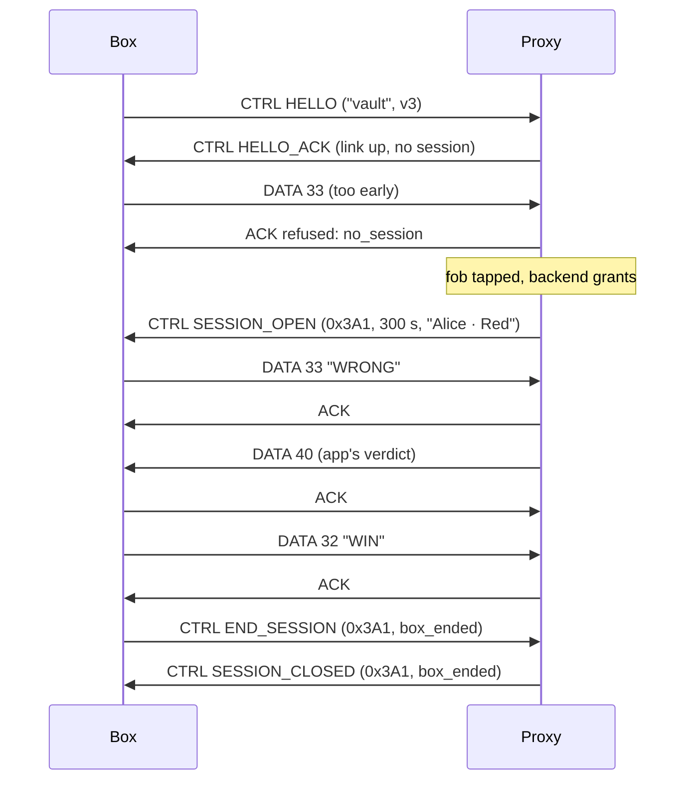

# boxlink: the box ↔ proxy UART protocol

| | |
|---|---|
| Status | Draft |
| Version | 1 |

boxlink carries messages between a box and its rfidprox over a UART. It borrows roclink's header (type, flags, seq, schema) and drops what a point-to-point wire doesn't need: networks, addresses and security. It adds framing and a checksum, which a byte stream needs and roclink doesn't define.

The box is untrusted. boxlink gives it no way around the proxy's gate: data it sends with no session open is refused (DESIGN.md §6.2).

## 1. Physical layer

| | |
|---|---|
| Levels | 3.3 V TTL. A 5 V box needs a level shifter on its side. |
| Settings | 115200 baud, 8 data bits, no parity, 1 stop bit, no flow control |
| Wires | TX, RX, GND. The box has its own power supply; only ground is shared. |
| Connector | JST-XH 3-pin on the proxy: 1 GND, 2 proxy TX → box RX, 3 box TX → proxy RX |

## 2. Framing

Each frame is COBS-encoded and ends with a `0x00` byte. COBS removes every zero from the encoded bytes, so `0x00` always means "end of frame", and a receiver that starts mid-stream resynchronises at the next one.

```
  on the wire:  COBS( header | payload | crc16 )  0x00
```

A receiver discards a frame that fails COBS decoding, is shorter than 6 bytes, or fails its CRC. It never answers a bad frame: the sender's retry covers it.

## 3. Frame

| Bytes | Field | Notes |
|---|---|---|
| 0 | `ver_type` | bits 7–5: version (1); bits 4–2: type; bits 1–0: 0 |
| 1 | `flags` | bit 0 `ACK_REQ`; others 0 |
| 2 | `seq` | per sender, incremented for each new frame; a retry repeats it |
| 3 | `schema` | `DATA`: 32–255, the box's message schema. `CTRL`: the control operation. `ACK`: 0 |
| 4 … n | `payload` | 0 to 200 bytes |
| n+1 … n+2 | `crc16` | CRC-16/CCITT-FALSE (poly 0x1021, init 0xFFFF) over bytes 0 … n, little-endian |

Integers in payloads are little-endian.

**Types:**

| Type | Name | Direction | Meaning |
|---|---|---|---|
| 0 | `DATA` | both | Box data: the box's messages to its app, and the app's replies |
| 1 | `ACK` | both | Acknowledges `seq`; with a 1-byte payload it's a refusal (§5) |
| 2 | `CTRL` | both | Control operations (§4) |

The payload limit is 200 bytes so that, with the session id and roclink's overhead, a box message fits one LoRa frame (DESIGN.md §6.4). Over LoRa, keep messages much smaller: every byte costs airtime.

## 4. Control operations

`CTRL` frames, with the operation in `schema`:

| Op | Name | Direction | Payload |
|---|---|---|---|
| 1 | `HELLO` | box → proxy | `ver` u8, `box_type` (length-prefixed string, ≤ 16), `box_version` u16 |
| 2 | `HELLO_ACK` | proxy → box | `ver` u8, `proxy_version` u16, `max_payload` u8, `link` u8 (§4.1), `session` u16 (0 = none) |
| 3 | `PING` | box → proxy | none. The box sends it (or any frame) at least every 5 s |
| 4 | `STATUS` | proxy → box | `link` u8, `session` u16, `budget` u8 (messages left this minute) |
| 5 | `SESSION_OPEN` | proxy → box | `session` u16, `lifetime_s` u16, `label` (length-prefixed string, ≤ 24) |
| 6 | `SESSION_CLOSED` | proxy → box | `session` u16, `reason` u8 (§4.2) |
| 7 | `END_SESSION` | box → proxy | `session` u16, `reason` u8: the box ends the session (puzzle solved, user gave up) |
| 8 | `DENIED` | proxy → box | `result` u8, `verdict` u8, `arg` u16, `label`: a fob was tapped and refused, so the box can show why |

The proxy sends `STATUS` whenever the link state or the session changes, and in answer to `PING` when the box sets `ACK_REQ`.

### 4.1 Link

| Value | Meaning |
|---|---|
| 0 | down: no session can open |
| 1 | up |
| 2 | grace: down, the session is kept (DESIGN.md §6.3) |

### 4.2 Session close reasons

| Value | Name |
|---|---|
| 1 | `box_ended` |
| 2 | `revoked` |
| 3 | `expired` |
| 4 | `link_lost` |
| 5 | `box_lost` |
| 6 | `proxy_restart` |

## 5. Reliability

- A frame with `ACK_REQ` is answered with `ACK` (same `seq`) as soon as the receiver has taken it.
- The sender retries the identical bytes after 200 ms, up to 3 times. A receiver that sees a repeated `seq` (from the same sender, within 2 s) ACKs it again and doesn't deliver it twice.
- One unacknowledged frame at a time in each direction (stop-and-wait). At 115200 baud that's still far faster than any radio behind it.

**Refusals** are an `ACK` with a 1-byte payload:

| Code | Name | Meaning | What the box does |
|---|---|---|---|
| 1 | `no_session` | DATA while no session is open | Drop it, or keep it until `SESSION_OPEN` |
| 2 | `busy` | over the rate budget, or the grace buffer is full | Retry later |
| 3 | `too_long` | payload over `max_payload` | Split it |
| 4 | `bad_schema` | DATA schema below 32 | Fix the firmware |
| 5 | `stale` | wrong session id in `END_SESSION` | Use the current one |

## 6. Box data

`DATA` frames carry the box's own messages, in the schemas it defines (32–255). The proxy adds the session id and forwards each one as a roclink frame on the same schema: it never looks inside. Replies from the app come back the same way, as `DATA` frames on the app's schemas, with the session id removed.

The box and its app agree on the schemas and payloads. For scavhunt that is GAME.md's messages, renumbered into 32+ (DESIGN.md §9).

## 7. A session, from the box's side



## 8. Liveness

- The box sends something at least every 5 s; `PING` if it has nothing else.
- The proxy considers the box gone after 15 s of silence, and closes any session with `box_lost`.
- A box that restarts sends `HELLO`. If a session was open, the proxy closes it (`box_lost`): the box has lost its state, so the user taps again.
