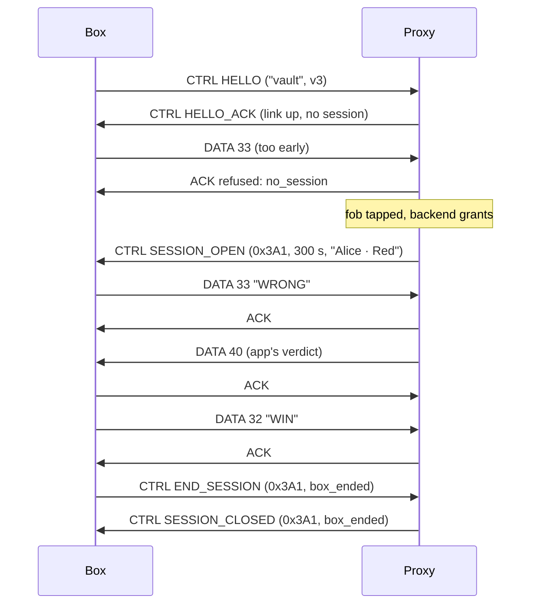

# boxlink: the box ↔ proxy UART protocol

| | |
|---|---|
| Status | Draft; the demo profile (§9) is implemented |
| Version | 1 |
| Code | [`boxlink/`](../boxlink): the framing, and `BoxLink`, the box's side, as an Arduino library. `firmware/src/gamebox.cpp` is the proxy's side. `tools/boxsim.py` plays a box. |

boxlink carries messages between a box and its rfidprox over a UART. It borrows roclink's header (type, flags, seq, schema) and drops what a point-to-point wire doesn't need: networks, addresses and security. It adds framing and a checksum, which a byte stream needs and roclink doesn't define.

The box is untrusted. boxlink gives it no way around the proxy's gate: data it sends with no session open is refused (DESIGN.md §6.2).

## 1. Physical layer

| | |
|---|---|
| Levels | 3.3 V TTL. A 5 V box needs a level shifter on its side. |
| Settings | 115200 baud, 8 data bits, no parity, 1 stop bit, no flow control |
| Wires | TX, RX, GND. The box has its own power supply; only ground is shared. |
| Connector | JST-XH 3-pin on the proxy: 1 GND, 2 proxy TX → box RX, 3 box TX → proxy RX |

## 2. Framing

Each frame is COBS-encoded and ends with a `0x00` byte. COBS removes every zero from the encoded bytes, so `0x00` always means "end of frame", and a receiver that starts mid-stream resynchronises at the next one.

```
  on the wire:  COBS( header | payload | crc16 )  0x00
```

A receiver discards a frame that fails COBS decoding, is shorter than 6 bytes, or fails its CRC. It never answers a bad frame: the sender's retry covers it.

## 3. Frame

| Bytes | Field | Notes |
|---|---|---|
| 0 | `ver_type` | bits 7–5: version (1); bits 4–2: type; bits 1–0: 0 |
| 1 | `flags` | bit 0 `ACK_REQ`; others 0 |
| 2 | `seq` | per sender, incremented for each new frame; a retry repeats it |
| 3 | `schema` | `DATA`: 32–255, the box's message schema. `CTRL`: the control operation. `ACK`: 0 |
| 4 … n | `payload` | 0 to 200 bytes |
| n+1 … n+2 | `crc16` | CRC-16/CCITT-FALSE (poly 0x1021, init 0xFFFF) over bytes 0 … n, little-endian |

Integers in payloads are little-endian.

**Types:**

| Type | Name | Direction | Meaning |
|---|---|---|---|
| 0 | `DATA` | both | Box data: the box's messages to its app, and the app's replies |
| 1 | `ACK` | both | Acknowledges `seq`; with a 1-byte payload it's a refusal (§5) |
| 2 | `CTRL` | both | Control operations (§4) |

The payload limit is 200 bytes so that, with the session id and roclink's overhead, a box message fits one LoRa frame (DESIGN.md §6.4). Over LoRa, keep messages much smaller: every byte costs airtime.

## 4. Control operations

`CTRL` frames, with the operation in `schema`:

| Op | Name | Direction | Payload |
|---|---|---|---|
| 1 | `HELLO` | box → proxy | `ver` u8, `box_type` (length-prefixed string, ≤ 16), `box_version` u16 |
| 2 | `HELLO_ACK` | proxy → box | `ver` u8, `proxy_version` u16, `max_payload` u8, `link` u8 (§4.1), `session` u16 (0 = none) |
| 3 | `PING` | box → proxy | none. The box sends it (or any frame) at least every 5 s |
| 4 | `STATUS` | proxy → box | `link` u8, `session` u16, `budget` u8 (messages left this minute) |
| 5 | `SESSION_OPEN` | proxy → box | `session` u16, `lifetime_s` u16, `label` (length-prefixed string, ≤ 24) |
| 6 | `SESSION_CLOSED` | proxy → box | `session` u16, `reason` u8 (§4.2) |
| 7 | `END_SESSION` | box → proxy | `session` u16, `reason` u8: the box ends the session (puzzle solved, user gave up) |
| 8 | `DENIED` | proxy → box | `result` u8, `verdict` u8, `arg` u16, `label`: a fob was tapped and refused, so the box can show why |
| 9 | `TRIGGER` | box → proxy | `trigger` u8, `arg` u8: a game event (§9) |
| 10 | `VERDICT` | proxy → box | `result` u8, `arg` u16, `solved` u8, `required` u8: the game's answer (§9) |

The proxy sends `STATUS` whenever the link state or the session changes, and in answer to `PING` when the box sets `ACK_REQ`.

### 4.1 Link

| Value | Meaning |
|---|---|
| 0 | down: no session can open |
| 1 | up |
| 2 | grace: down, the session is kept (DESIGN.md §6.3) |

### 4.2 Session close reasons

| Value | Name |
|---|---|
| 1 | `box_ended` |
| 2 | `revoked` |
| 3 | `expired` |
| 4 | `link_lost` |
| 5 | `box_lost` |
| 6 | `proxy_restart` |

## 5. Reliability

- A frame with `ACK_REQ` is answered with `ACK` (same `seq`) as soon as the receiver has taken it.
- The sender retries the identical bytes after 200 ms, up to 3 times. A receiver that sees a repeated `seq` (from the same sender, within 2 s) ACKs it again and doesn't deliver it twice.
- One unacknowledged frame at a time in each direction (stop-and-wait). At 115200 baud that's still far faster than any radio behind it.

**Refusals** are an `ACK` with a 1-byte payload:

| Code | Name | Meaning | What the box does |
|---|---|---|---|
| 1 | `no_session` | DATA while no session is open | Drop it, or keep it until `SESSION_OPEN` |
| 2 | `busy` | over the rate budget, or the grace buffer is full | Retry later |
| 3 | `too_long` | payload over `max_payload` | Split it |
| 4 | `bad_schema` | DATA schema below 32 | Fix the firmware |
| 5 | `stale` | wrong session id in `END_SESSION` | Use the current one |
| 6 | `offline` | the proxy has no link to a gateway, or the gateway didn't acknowledge it | Retry later; watch `STATUS` |
| 7 | `unknown` | an unknown control operation or trigger | Fix the firmware |

## 6. Box data

`DATA` frames carry the box's own messages, in the schemas it defines (32–255). The proxy adds the session id and forwards each one as a roclink frame on the same schema: it never looks inside. Replies from the app come back the same way, as `DATA` frames on the app's schemas, with the session id removed.

The box and its app agree on the schemas and payloads. For scavhunt that is GAME.md's messages, renumbered into 32+ (DESIGN.md §9).

## 7. A session, from the box's side



## 8. Liveness

- The box sends something at least every 5 s; `PING` if it has nothing else.
- The proxy considers the box gone after 15 s of silence, and closes any session with `box_lost`.
- A box that restarts sends `HELLO`. If a session was open, the proxy closes it (`box_lost`): the box has lost its state, so the user taps again.

## 9. The demo profile

What the scavenger hunt demo runs today, before rfidauth and GAME.md 0.3. It's this protocol with these differences:

**Logging in.** There's no fob reader: a button on the proxy logs in with a dummy fob (`f0b0` and the node address: `f0b00301` for `0x0301`), and holding it 1.5 s logs out. The proxy then sends `SESSION_OPEN` (label `fob f0b00301`, lifetime 0: no expiry) or `SESSION_CLOSED`.

**Box data is forwarded unchanged,** without the session id of §6: a `DATA` frame on schema *s* becomes a roclink frame on schema *s* with exactly the box's bytes. The box decides what the bytes mean; the hub's config declares the layout (roclink-hub README, "Payload decoders"), so the proxy never needs to know. Like §6.2's gate, box data needs a session: with no one logged in it's refused `no_session` and nothing leaves the proxy. At most four `DATA` frames a second: faster ones are refused `busy`.

```c
struct __attribute__((packed)) Reading { int16_t temp_cC; float humidity; uint8_t flags; };
proxy.send(32, reading);   // BoxLink: 7 bytes on schema 32
```

```toml
[decoder.vault-reading]    # the hub's config: the same 7 bytes
struct = "<hfB"
fields = ["temp_c", "humidity", "flags"]
scale = { temp_c = 0.01 }
bits = { flags = ["door_open", "lid_closed"] }
```

Downlink on schemas 32–255 from the hub comes back to the box the same way, as `DATA`.

**Game events** are `CTRL TRIGGER` (op 9), because the proxy must add the logged-in team's token (GAME.md 0.2):

| `trigger` | Event | Sent to the game as | `arg` |
|---|---|---|---|
| 1 | win: the puzzle is solved | `WIN` | |
| 2 | fail: a wrong answer | `WRONG` | |
| 3 | hint | `HINT` | the hint number; 0 for the next one |
| 4 | end: the team gave up | `END` (the session closes) | |

A trigger needs a session (`no_session` otherwise), and one waiting for the game's verdict refuses the next (`busy`). `END_SESSION` (op 7) works as trigger 4.

**Verdicts** come back as `CTRL VERDICT` (op 10), with GAME.md §6's result codes: 0 solved, 1 solved and finished, 2 already solved, 3 locked (`arg`: the box to solve first), 4 unknown team, 5 not running, 6 go (`arg`: hints taken), 7 busy (`arg`: seconds), 8 no session, 9 hint granted (`arg`: its number), 10 no more hints.

**Timing.** The proxy answers a frame once it has forwarded it, which takes up to about 2 s when the gateway is slow, so the box waits up to 3 s for an answer and sends the same bytes once more (not §5's 200 ms, three times). A frame repeated with the same `seq` within 10 s is answered again and not repeated. The proxy doesn't ask the box for ACKs: its frames carry a CRC, and the box can always `PING` for the `STATUS`.

**No liveness check** of the box yet (§8): the proxy doesn't close a session when the box goes quiet.

**The USB port.** For testing, the proxy accepts frames on its USB serial port too, and once one arrives, sends the box's frames there as well, between its log lines. `tools/boxsim.py /dev/ttyUSB0` uses this.

**The boards.** The proxy's game-box build runs on two:

| | Heltec V3 / V4 (`heltec_v3_gamebox`; over LoRa: `heltec_v3_gamebox_lora`) | XIAO ESP32-S3 (`xiao_gamebox`) |
|---|---|---|
| Radio | Wi-Fi, or LoRa (915.0 MHz, SF9) | Wi-Fi |
| Node | `0x0301` | `0x0302` |
| Box port: proxy TX → box RX | GPIO 40 (J3-9) | GPIO 43 (D6) |
| Box port: box TX → proxy RX | GPIO 39 (J3-10) | GPIO 44 (D7) |
| Login button | PRG, on the board | a push button from D0 (GPIO 1) to GND |
| Shows the state on | the OLED | the user LED: blinking, no link; off, ready; flickering, waiting for the game; on, logged in |

Wire GND too. Both are 3.3 V. `roclink-scavbox-wifi` is a box for the XIAO example, and `roclink-scavbox-lora` (an ESP32-S3 DevKit) for the Heltec over LoRa.

Over LoRa, forwarding a frame takes about half a second (its airtime, then the gateway's ACK 150 ms after it ends), and a lost ACK costs 1.2 s before the retry: still within the box's 3 s per attempt.

