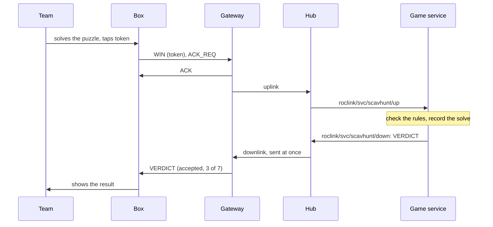
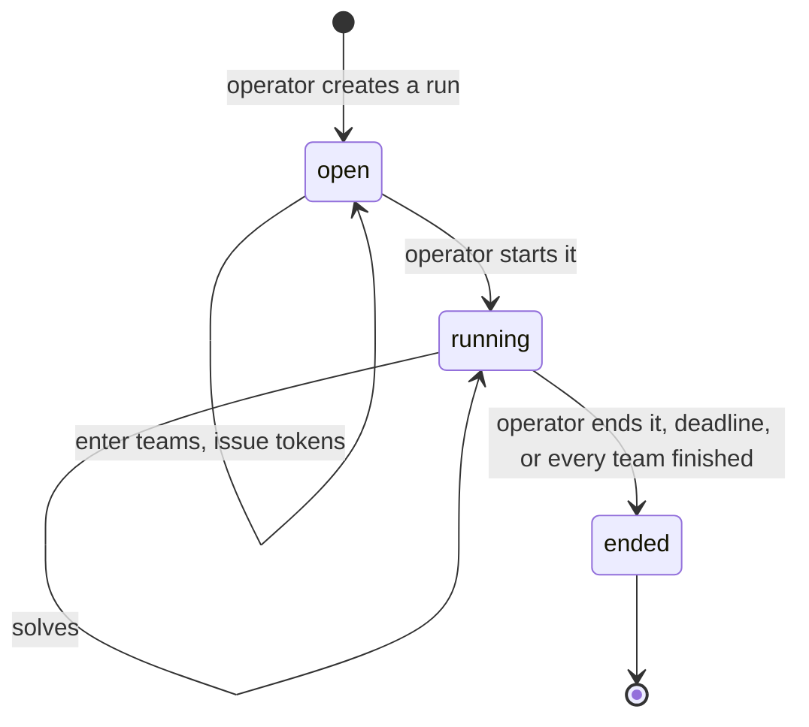
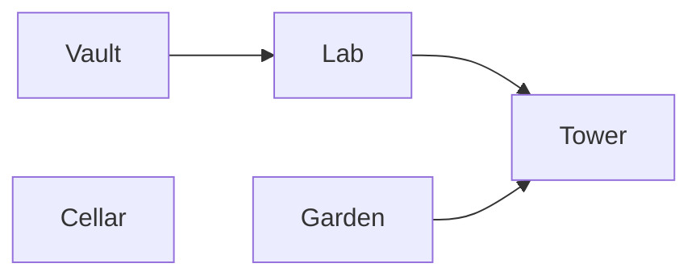
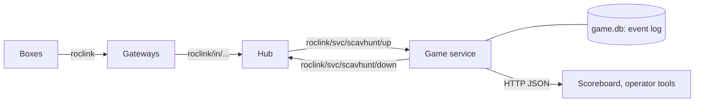

# roclink Scavenger Hunt: game specification

| | |
|---|---|
| Status | Draft |
| Runs on | roclink wire protocol v1 (secured), a roclink hub, and this game service |
| Version | 0.1 |

## 1. The game in one paragraph

Teams move around a space solving physical puzzles: *boxes* built from embedded devices. When a team solves a box, the team taps its *token* on the box, and the box sends a `WIN` message over roclink. The game service checks the claim against the rules, records the box as solved for that team, and tells the box the result so it can show it. A team that solves every required box has *finished*. Teams are ranked by when they finished.

## 2. Vocabulary

| Term | Meaning |
|---|---|
| **Box** | One physical puzzle, with one roclink node in it. Known to the game by its roclink address `(net, node)`. |
| **Game** | A definition, written once: its boxes, the order they open in (prerequisites), which boxes are required, and an optional time limit. |
| **Run** | One playing of a game, with a start and an end. A game can be run many times. |
| **Player** | A person playing. The game doesn't track players individually; they play as a team. |
| **Team** | One or more players, entered in a run, who share progress. A single player is a team of one. |
| **Token** | What a team taps or types on a box to say who they are: an NFC or RFID card, or a short code. Each token belongs to exactly one team in a run. |
| **Solve** | A team's accepted claim that it has solved a box. |
| **Progress** | The set of boxes a team has solved in a run. |
| **Prerequisite** | A box another box depends on: box *b* opens for a team once all its prerequisites are in that team's progress. |
| **Open box** | A box whose prerequisites a team has all solved. |
| **Finished** | A team whose progress contains every required box. |
| **Verdict** | The game's answer to a `WIN` claim, sent back to the box (§6). |
| **Operator** | Whoever runs the game: defines it, enters teams, starts and ends runs, resets boxes. |

## 3. Formal model

**A game** is *G = (B, pre, R, L)*:
- *B* is the finite set of boxes.
- *pre : B → 2^B* gives each box's prerequisites. The relation must be acyclic, so every box can be reached.
- *R ⊆ B* is the set of required boxes. By default *R = B*; boxes outside *R* are optional, worth points but not needed to finish.
- *L* is an optional time limit.

**A run** of *G* has:
- a set of teams *T*;
- a token map *tok*, from each token to one team in *T*;
- a state, which is one of `open` (teams can be entered), `running` or `ended`;
- a start time *t₀* and, while running, the deadline *t₀ + L* if *L* is set.

**Progress:** for each team *t*, *S(t) ⊆ B* is the set of boxes it has solved, initially empty. *S(t)* only grows.

**Open boxes:** box *b* is open for *t* when *pre(b) ⊆ S(t)*.

**A claim** is *(k, b, τ)*: token *k* presented at box *b*, received by the hub at time *τ*. The claim is **accepted** when all of these hold:
1. the run is `running`, and *τ* is before the deadline;
2. *k* is a known token, so *t = tok(k)* exists;
3. *b ∈ B*;
4. *b ∉ S(t)* (otherwise the verdict is `already solved`);
5. *pre(b) ⊆ S(t)* (otherwise the verdict is `locked`).

An accepted claim adds *b* to *S(t)* and records a solve *(t, b, τ)*.

**Finishing:** team *t* has finished when *R ⊆ S(t)*. Its finish time *f(t)* is the time of the solve that completed *R*.

**The run ends** when the operator ends it, the deadline passes, or every team has finished.

**Standings** order teams by these keys:
1. finished teams first, by finish time *f(t)*, earliest first;
2. then unfinished teams, by number of required boxes solved, most first;
3. then by the time of their last solve, earliest first;
4. then by number of optional boxes solved, most first.

The *winner* is the first team in the standings, if it has finished.

## 4. Rules

1. **One box, one roclink node.** A box is identified only by its roclink address. Its messages are secured (level `enc`), so a box can't be impersonated over the air (roclink PROTOCOL.md §10).
2. **The box decides whether its puzzle is solved; the game decides whether the solve counts.** A box never knows a team's progress. It sends `WIN` and shows the verdict it gets back.
3. **Every team solves every box.** Boxes are shared. After a solve, a box resets for the next team.
4. **Order is set by the game.** A box can be played any time, but a `WIN` for a box that isn't open for that team is refused as `locked`, and the box says which box to solve first.
5. **Solving twice changes nothing.** A second `WIN` from the same team for the same box is answered `already solved`.
6. **The hub's clock decides.** Solve times are the hub's receive times, never the box's. Claims after the deadline are refused.
7. **Tokens are per run.** The operator issues them when entering teams. A token that isn't in the run is refused as `unknown team`.
8. **Operators can correct.** The operator can add or remove a solve for a team. Corrections are recorded as events of their own, so the history shows what was changed and when.

## 5. Flows

**A solve.** Boxes are mains-powered and *always-listening* (roclink PROTOCOL.md §1), so the verdict reaches the box as soon as the game has decided, without waiting for the box's next uplink.



**A run.**



**A team's progress through a game with prerequisites.** Here *Lab* needs *Vault*, and *Tower* needs both *Lab* and *Garden*:



At the start, *Vault*, *Garden* and *Cellar* are open. A `WIN` at *Tower* before *Lab* and *Garden* are solved is answered `locked`.

## 6. Messages

Boxes are one roclink device type, `scavhunt-box`, so these message schemas belong to it alone (roclink PROTOCOL.md §5). All integers are little-endian.

**Uplink, schema 1: `WIN`.** Sent with `ACK_REQ`.

| Bytes | Field | Notes |
|---|---|---|
| 0 | version | 1 |
| 1 | token length *n* | 1–16 |
| 2 … 1+*n* | token | the NFC card's UID, or the bytes of a typed code |

**Uplink, schema 2: `ATTEMPT`** (optional). A token was tapped but the puzzle isn't solved yet, which helps show which teams are where. Same layout as `WIN`. The game records it and doesn't reply.

**Downlink, schema 10: `VERDICT`.**

| Bytes | Field | Notes |
|---|---|---|
| 0 | version | 1 |
| 1 | result | 0 accepted, 1 accepted and finished, 2 already solved, 3 locked, 4 unknown team, 5 not running |
| 2 | solved | required boxes this team has solved |
| 3 | required | required boxes in the game |
| 4–5 | needs | for `locked`: the node address of one box to solve first, else 0 |

**Downlink, schema 11: `CONTROL`** (operator). Byte 0 is the version, byte 1 the command: 1 reset the puzzle, 2 disable the box, 3 enable it.

## 7. Cheating, and what stops it

| Attack | Stopped by |
|---|---|
| Forging a `WIN` over the air | roclink security: `enc` level, per-box keys. Only the box's key can produce its `WIN` |
| Replaying a recorded `WIN` | roclink frame counters at the gateway, and the hub's replay window across gateways |
| Claiming for a box out of order | the `locked` rule (§3 condition 5) |
| Claiming after time | the hub's clock and the deadline (rule 6) |
| Copying another team's token | Nothing technical; it only gives progress to the other team. Use cards that can't be read at a distance, and keep a staff member near high-value boxes if it matters |
| Opening a box and triggering its `WIN` by hand | Physical. A box's key can only claim that box's own solves, and a stolen box can be revoked (roclink `deny` policy) |

## 8. The backend

The game is a **hub service**: a separate program that the hub delivers its boxes' uplinks to, and that sends downlink back through the hub. The hub stays generic.



- **Input:** the hub delivers each `WIN` and `ATTEMPT` uplink from a `scavhunt-box` as a JSON record on `roclink/svc/scavhunt/up`. It has already been verified, decrypted and de-duplicated across gateways.
- **Output:** a `VERDICT` is a downlink request on `roclink/svc/scavhunt/down`. The hub numbers it and sends it through the gateway that heard the box.
- **State:** an append-only event log in SQLite: team entered, run started, claim (with its verdict), attempt, correction, run ended. Operator commands write to the same log, and the service picks them up. Progress and standings are computed from it, so the history is never lost, and a restart rebuilds the state.
- **Idempotent:** the hub delivers at least once, so the same uplink can arrive twice. The service ignores a record whose `(net, src, key_gen, fcnt)` it has already handled, and a repeated solve is harmless anyway.
- **Scoreboard:** read-only HTTP JSON (`/api/standings`, `/api/run`). The broker's ACL lets a service write only its own `down` topic, which keeps the scoreboard off MQTT.

**Hub configuration** for the game:

```toml
[[device_type]]
name = "scavhunt-box"
class = "always_listening"

[[node]]
net = 0x42
nodes = ["0x0200-0x02FF"]
type = "scavhunt-box"

[[route]]
service = "scavhunt"
net = 0x42
types = ["scavhunt-box"]
```

## 9. Open questions

1. **Hints:** should a team be able to ask a box for a hint, at a time penalty?
2. **Scoring beyond finish times:** points per box, or a penalty for wrong attempts, if boxes report them?
3. **Box-to-team displays:** should the verdict include the team's name, for boxes with a screen?
