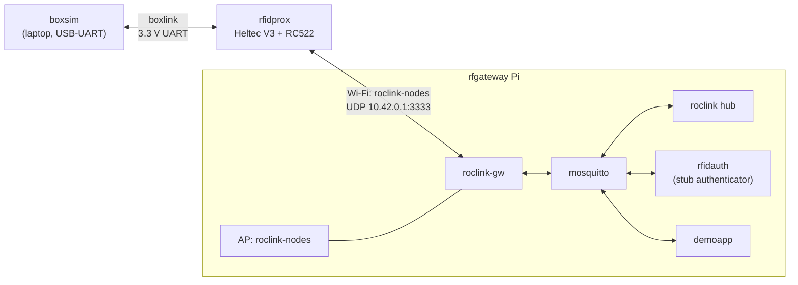

# Plan: the Wi-Fi UDP example, end to end

| | |
|---|---|
| Status | Plan, for review before work starts |
| Goal | One rfidprox (Heltec V3) on Wi-Fi, through an access point on the rfgateway Pi, through the full backend, with a simulated box |

## 1. What it shows

The whole rfidprox flow over its first transport: tap a fob, get a grant, open a session, carry box data both ways, and handle the ways a session ends.

## 2. The access point

### 2.1 Sharing the Pi's one radio

The Pi 3's Wi-Fi chip can run an AP and a client at once, but only on one channel (`iw list`: `#{ managed } <= 1, #{ AP } <= 1 … #channels <= 1`). The client is on `jv_testing`, channel 6, so the AP must be on channel 6 too.

| Option | Hardware | For | Against |
|---|---|---|---|
| A. AP and client on the built-in radio | none | Works today | The AP follows the upstream channel: if `jv_testing` moves, the AP drops. The driver is known to be touchy in this mode. Half the airtime each. |
| B. A USB Wi-Fi adapter for the AP | one adapter with AP support (e.g. an MT7601U or RTL8188-based dongle; check `iw list`) | Independent radios; the AP picks its own channel | One more part |
| **C. Ethernet for the Pi, built-in radio as the AP** (chosen, and set up) | a cable | Most robust | The Pi needs a wired drop |

Option C is in place: the Pi is on the LAN by Ethernet at `192.168.8.237`, and its built-in radio is the AP. The role keeps the interface a variable, so a USB adapter (B) would be a config change.

### 2.2 The network

| | |
|---|---|
| SSID | `roclink-nodes`, WPA2-PSK (CCMP), passphrase in the vault (a demo value, `roclink-demo`, for now) |
| Interface | `wlan0`, channel 1 (2.4 GHz; away from the LAN AP's channel 6). PMF off: the Pi's driver can't do it as an AP |
| Addresses | `10.42.0.0/24`; the Pi is `10.42.0.1`; DHCP from dnsmasq (`10.42.0.50`–`.250`), with no router or DNS offered |
| Isolation | No routing from `roclink-nodes` to the LAN or the internet: nftables drops forwarding from `wlan0`. Nodes reach only DHCP, ping and the Pi's UDP 3333. |
| Gateway | `roclink-gw` already listens on `0.0.0.0:3333`: no change |

### 2.3 Done: the `node_ap` role in roclink-gateway

- **hostapd** runs the AP (WPA2-PSK, CCMP, no PMF), and NetworkManager leaves `wlan0` unmanaged. NetworkManager's own AP mode was tried first: on the Pi 3's brcmfmac it advertised `WPA-PSK-SHA256` alongside `WPA-PSK`, and an iPhone failed the handshake with the right password.
- **dnsmasq** gives out addresses on `wlan0` only, with DNS off; a oneshot unit sets `10.42.0.1/24`.
- **nftables**, its own table `roclink_ap`: from the node network only DHCP, ping and UDP 3333 reach the Pi, and nothing is forwarded.
- The Wi-Fi client connection is kept, with autoconnect off.

Checked: an iPhone joins, gets `10.42.0.212`, and its other traffic is dropped.

## 3. The backend on the Pi

| Part | Where it comes from | New? |
|---|---|---|
| roclink hub | the `roclink-hub` repository (the demo hub, moved out of `roclink_`) | New role in roclink-gateway: `hub`, with routes for device type `rfidprox`: schemas 1–31 to `rfidauth`, 32–255 to `demoapp` |
| rfidauth | `rfidprox/backend/rfidauth` | New: Python, as BACKEND.md §5, with the stub authenticator and `fobs.toml` |
| demoapp | `rfidprox/backend/demoapp` | New: a minimal app for the example. It authorizes anyone with a valid fob (`busy` if the box has a session), echoes box data back on schema + 1, and shows sessions on a web page. scavhunt replaces it once GAME.md 0.3 is done. |
| MQTT users and ACL | roclink-gateway `mosquitto` role | Add `rfidauth`, `demoapp`, and the `roclink/authz/#` rules |

## 4. The firmware

A PlatformIO project in `rfidprox/firmware`, Arduino-ESP32 3.x, for the Heltec V3.

| Module | Does | Built on |
|---|---|---|
| `transport` | send and receive roclink frames. `udp` first; `lora` (RadioLib SX1262) next, behind the same interface | WiFiUDP bound to port 3333, so the gateway's replies and "now" downlink reach it |
| `link` | the roclink node: seal, open, frame counter and chain key in NVS, daily ratchet, `PING` heartbeat, retries | roclink-rfc `src/` |
| `session` | the state machine (DESIGN.md §6.1), the gate, grace buffer, renewals, rate budget | |
| `boxlink` | framing (COBS, CRC-16), ACKs and retries, control operations | BOXLINK.md |
| `reader` | RC522 polling, UID and card type, debouncing repeated taps | MFRC522v2 (the maintained library) |
| `ui` | OLED messages, buzzer, LED | U8g2 |
| `config` | Wi-Fi credentials, gateway address, node address and key | `secrets.h` (git-ignored) from `provision.py`, demo keys otherwise |

Proposed defaults: node address `0x0301` on net `0x42` (demo master key).

**Needed in roclink-rfc first:** node-side `PING` (PROTOCOL.md §7.1, specified but not built): a builder for the schema-0 frame, about 20 lines with a test vector.

## 5. The test box: boxsim

`rfidprox/tools/boxsim.py`: plays a box over a 3.3 V USB-UART adapter (CP2102, FT232 or CH340 at 3.3 V) wired to the proxy's box port (HARDWARE.md §2.2).

- Speaks boxlink: `HELLO`, `PING`, `DATA`, `END_SESSION`; prints everything the proxy sends.
- Interactive: `send 33 hello`, `end`, `silent` (stop pinging, to test `box_lost`), `reboot`.
- Reusable as the reference for box builders, alongside a small `boxlink.h` for box firmware later.

## 6. Steps, each with its check

| # | Step | Done when |
|---|---|---|
| 1 | `node_ap` role (**done**) | A phone joins `roclink-nodes`, gets `10.42.0.x`, can't reach the LAN; `test_node.py` from a laptop on the AP gets a sealed ACK |
| 2 | roclink-rfc node `PING` (**done**) | Test vector passes; gateway publishes the `PING` record |
| 3 | Firmware: transport, link, config | The Heltec joins the AP; `HELLO` and `PING`s are ACKed; records appear on MQTT; a reboot doesn't reuse a counter |
| 4 | hub role, rfidauth, demoapp | A scripted `AUTH_REQ` (a test_node variant) gets `GRANT`; an unknown UID gets result 1 |
| 5 | Firmware: reader, ui, session | A fob tap shows "Alice: go" on the OLED; an unknown fob shows why |
| 6 | Firmware: boxlink; boxsim | Box DATA refused before a session, forwarded during one; demoapp's echo reaches boxsim |
| 7 | Endings and failures | Each DESIGN.md §5.5 cause works: box ends it, revoke from demoapp's page, expiry (renewal blocked), AP switched off past grace, boxsim `silent`, proxy reset |

Steps 1–2 and 4 don't need the board; 3 needs only the Heltec; 5 adds the RC522; 6 the UART adapter.

## 7. Repository changes

| Repository | Adds |
|---|---|
| `rfidprox` | `firmware/`, `backend/rfidauth/`, `backend/demoapp/`, `tools/boxsim.py`, tests for the backend and for boxlink framing (host-side C tests, as in roclink-rfc) |
| `roclink-gateway` | role `hub` (installing from `roclink-hub`); MQTT users and ACL; deploying rfidauth and demoapp. (`node_ap` is done.) |
| `roclink-rfc` | node-side `PING` |

## 8. Decisions

| Decision | Choice |
|---|---|
| Access point | Option C: Ethernet for the Pi, its Wi-Fi as the AP (§2.1). Set up. |
| RC522 library | MFRC522v2, the maintained one |
| Where the hub comes from | A new `roclink-hub` repository, copied from `roclink_/hub`; `roclink_` is left as it is |
