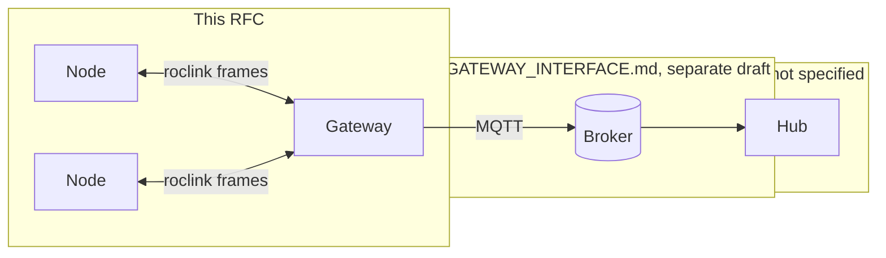
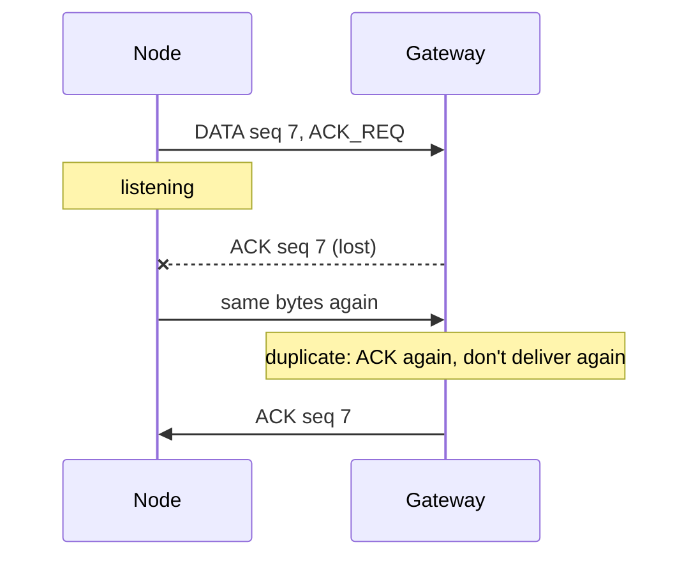
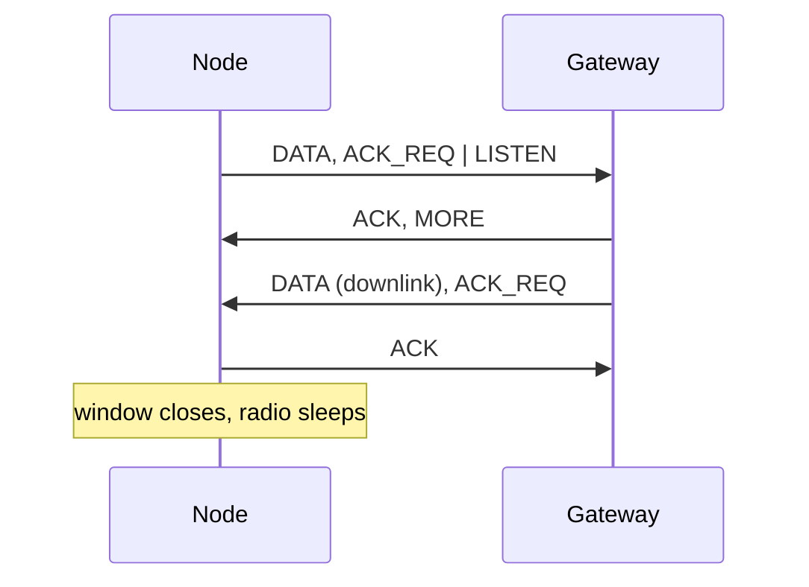
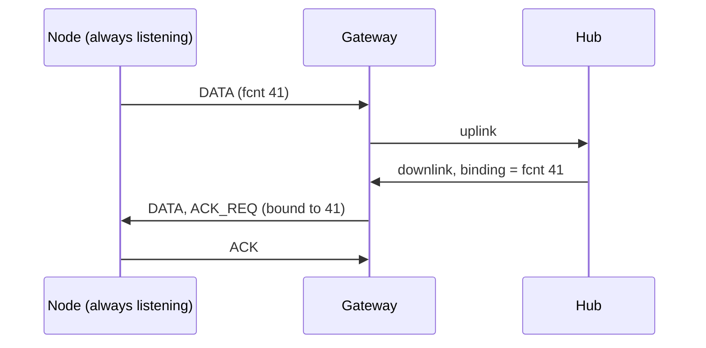
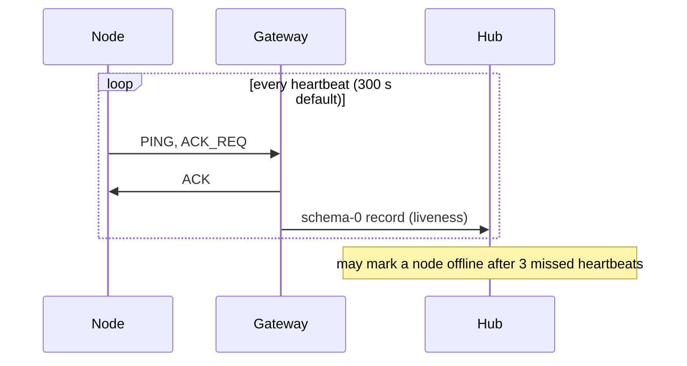
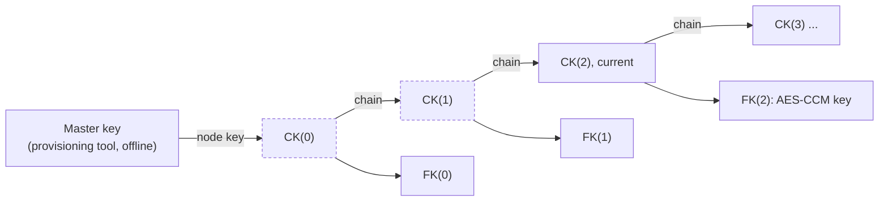
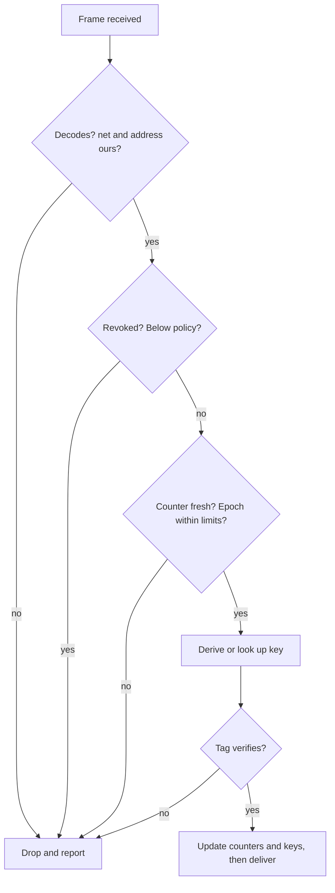
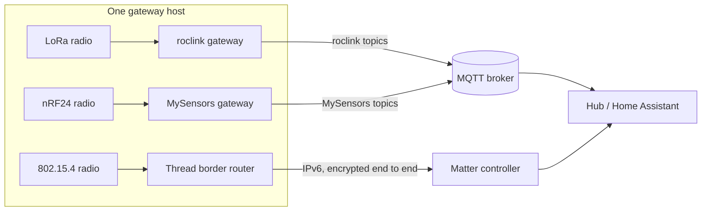

# RFC: roclink wire protocol v1 (draft)

| | |
|---|---|
| Status | Draft for review |
| Version | roclink 0.3, wire format v1 |
| Date | 2026-10-14 |
| Normative text | [PROTOCOL.md](PROTOCOL.md) (this RFC summarises it) |
| Asked of reviewers | Approve the wire format and the node and gateway rules |

## 1. Summary

roclink is a small envelope for messages between sensor and actuator boards (*nodes*) and the *gateways* that receive them, over any radio: LoRa, ESP-NOW, Wi-Fi/UDP, Wi-Fi HaLow, 433 MHz modules. Every frame carries a 9-byte header. Frames are authenticated and encrypted by default with AES-128-CCM, using per-node keys that ratchet forward daily.

This RFC covers nodes and gateways only. How gateways hand data to the system behind them (the *hub*) is a separate draft (GATEWAY_INTERFACE.md), and the hub's design is left open.

## 2. Goals

roclink is built for a public makerspace, where many makers share gateways and one hub.

1. **A protocol to learn from:** short, fixed, little-endian, fully written down, with test vectors.
2. **Any radio:** makers pick what reaches their spot and only define their device's data model.
3. **Simple and secure:** security comes in levels (`none`, `auth`, `enc`), so the plain frame can be studied on its own.
4. **Usable without understanding it:** a C99 library with no dependencies, and a short spec for those who want to dig in.

**Prior art, and why not:** LoRaWAN is LoRa-only and needs a network server. Thread and Matter need specific radios and a large stack. ESPHome is Wi-Fi and Home Assistant only. MySensors has small payloads and fixed message types. RadioHead has no security and no spec. roclink borrows from several: frame counters and bound ACKs from LoRaWAN, CCM from Zigbee, Thread and BLE, and device classes from LoRaWAN.

**Compared with the two closest options, for a maker:**

| | roclink | MySensors | Matter |
|---|---|---|---|
| Radios | any: LoRa, ESP-NOW, Wi-Fi, HaLow, 433 MHz, nRF24 | nRF24, RFM69, RFM95, RS485 | Wi-Fi, Ethernet, Thread (BLE to set up) |
| Smallest board | Arduino Uno, secured (17 KB flash) | Arduino Uno | ESP32-C6/H2, nRF52840 class |
| Payload | up to 233 B secured | 25 B on nRF24 | larger, over IP |
| Data model | yours, one schema per format | fixed sensor and value types | standard clusters |
| Shows up in Home Assistant by itself | no: you write a decoder | yes | yes |
| Security | on by default, per-node keys | opt-in; shared network key | strong; QR-code onboarding |
| Licence | MIT | GPL | Apache 2.0 SDK; certification for products |

roclink's main trade-off: any radio and full control of the payload, in exchange for writing your own decoders. A future "describe yourself" control message could close part of that gap (§13).

## 3. Scope



- **In scope:** the frame format; what nodes and gateways do with frames; security on the radio link.
- **Out of scope:** what the hub stores, routes, decodes or displays. The wire protocol asks only four things of any hub (§10).
- **Stability:** the wire format is meant to stay fixed. New features use reserved code points (frame types, schema-0 operations, security suites), as `PING` and `JOIN` do.

## 4. Frame format

All multi-byte fields are little-endian. There's no length field: the radio delivers whole frames.

| Bytes | Field | Notes |
|---|---|---|
| 0 | `ver` · `type` | version 1; DATA (0), ACK (1), JOIN (2) |
| 1 | `flags` | see below |
| 2 | `netId` | network id |
| 3–4 | `src` | sender: node `0001`–`FEFF`, gateway `FF00`–`FFFE` |
| 5–6 | `dst` | receiver; `0000` = any gateway |
| 7 | `seq` | matches ACKs; spots retransmissions |
| 8 | `schema` | message schema: which payload layout, per device type (LoRaWAN calls it FPort); 0 = roclink control |
| 9–13 | `sec_ctrl` · `fcnt` | only when `SECURED`: suite, level, tag size, key generation; 32-bit frame counter |
| … | payload | up to 246 B unsecured, 233 B secured (255-byte frame) |
| last 8 or 4 | tag | only when `SECURED` |

| Flag | Meaning |
|---|---|
| `ACK_REQ` | acknowledge this frame (implies `LISTEN` from a node) |
| `LISTEN` | the node listens for replies right after this frame |
| `MORE` | another gateway frame follows; keep listening |
| `DL_QUEUED` | more downlink is waiting |
| `SECURED` | security header and tag present |
| `RELAYED`, `HOPS` | reserved for relays |

## 5. Exchanges

**Uplink with ACK and retry.** A retry is the identical bytes. The gateway ACKs every copy but delivers only the first.



**Downlink in a listen window (sleepy node).** The gateway speaks only right after a node frame that says it's listening.



**Unsolicited downlink (always-listening node).** Mains-powered nodes keep their receiver on, so the hub can send at any time. The frame is bound to the node's latest uplink.



**PING: keepalive and link check.** A DATA frame with schema 0 and operation `0x01`. Its flags pick the meaning: none = "alive", `ACK_REQ` = link check, `LISTEN` = poll for downlink.



## 6. Security

| Level | Payload | Authenticated | Accepted by default |
|---|---|---|---|
| `none` | plain | no | only if allowed for that node, or on an open test net |
| `auth` | plain | yes | no (`require-auth` receivers) |
| `enc` | encrypted | yes | yes (the default) |

- **Cipher:** AES-128-CCM. The nonce is `src`, `dst`, `netId` and `fcnt`. It needs to be unique, not secret, and it's built from counters, so nodes need no random number generator.
- **Tags:** 8 bytes by default. 4 bytes is allowed only if the receiver lowers its minimum for that node.
- **The receiver decides:** a frame below the receiver's policy is dropped, so plaintext can't downgrade a link.
- **Replays:** every sender's 32-bit frame counter only goes up, and is persisted in blocks of 256. Gateway frames are bound to the node frame they answer.
- **Clones:** two authentic frames with the same counter and different content are reported as a conflict.

**Keys.** One key per node, derived with AES-CMAC (NIST SP 800-108), and ratcheted forward each epoch (daily):



Old chain keys are erased, so a node stolen in epoch 2 reveals nothing from epochs 0 and 1. Gateways should run in *enrolled mode*: they hold each node's current chain key, never the master.

**Receiving a frame.** Every check that needs no cryptography runs first, and nothing changes state until the tag verifies:



**Optional session mode** (for mains-powered nodes). At boot the node joins a gateway and both derive a fresh session key. Counters then restart at 0, nothing is persisted per frame, and a node restored from a flash image can't reuse a nonce.

```mermaid
sequenceDiagram
    participant N as Node
    participant G as Gateway
    N->>G: JOIN_REQ (sealed with FK(e), fcnt = join_fcnt)
    G->>N: JOIN_ACK (lifetime, heartbeat; fcnt = gw_fcnt)
    Note over N,G: SK = KDF(CK(e), net, node, key_gen, join_fcnt, gateway, gw_fcnt)
    N->>G: DATA under SK (fcnt 0, 1, 2, ...)
    Note over N: 3 unanswered ACK_REQs: the session is lost, so re-join
```

## 7. Message schemas and device types

The message schema (`schema`) says which payload layout and meaning a frame carries; a receiver needs the matching decoder. It works like LoRaWAN's FPort, renamed because it names a message format, not an endpoint. Schemas belong to a *device type*, one maker's firmware and data model, so each maker has their own 255 formats and no shared registry is needed. Schema 0 is reserved for roclink control messages.

## 8. Multiple gateways

- A node sends to `0x0000` (any gateway), or to one gateway directly.
- Every gateway that hears a frame passes it on; only gateways configured to "answer any" reply, so replies don't collide.
- A session-mode node sticks to the gateway it joined.

## 9. Sharing radios with other protocols

roclink has no protocol identifier in its header. The carrier settings keep protocols apart, and `netId`, the addresses and the tag do the rest.

- **Give roclink its own carrier settings:** frequency or LoRa sync word, ESP-NOW channel, UDP port. A radio only hears matching settings.
- **If it shares a channel anyway,** foreign packets aren't mistaken for data: about 1 in 300 million random frames would pass the header checks, and secured frames must also pass the tag. They're dropped as `malformed`, `net` or `addr`. The real cost is airtime, because overlapping packets corrupt each other.
- **One host can run several protocols,** with one radio and gateway stack each. Matter is different: its devices are IP hosts with end-to-end encryption, so the host runs a Thread border router that routes Matter packets without reading them.



## 10. What any hub must do

The hub is open, but the protocol's guarantees need four things from it:

1. **Give each node's downlinks their own sequence numbers.** The hub keeps a `seq` counter for every node, saves it across restarts, and starts it at a random value. A downlink that's retried, even through a different gateway, keeps its original `seq`, so the node recognises the repeat and doesn't act on it twice.
2. **Send each downlink frame through one gateway**, and supply the binding for always-listening and session-mode nodes.
3. **Refuse replays across gateways:** a frame recorded near one gateway and replayed to another.
4. **Never deliver schema-0 control messages** to applications.

## 11. Extensibility

| Reserved | For |
|---|---|
| Frame types 3–7 | new control frames (e.g. beacons) |
| Schema-0 operations `0x02`–`0xFF` | new control messages (e.g. time, configuration) |
| Security suites 1–3 | new ciphers (Ascon-AEAD128 is the candidate) |
| `RELAYED`, `HOPS`, relay id | relays |
| Broadcast address `0xFFFF` | group downlink (needs a group key) |

## 12. Open questions

1. **Uplink replies with several gateways:** keep "answer any" as configuration, or have nodes learn and address the gateway that answered them?
2. **Stream transports:** standardise a framing (e.g. COBS + CRC) for carrying roclink over UART and TCP, or leave it to each deployment?

## 13. Future work (not in this version)

- Per-session forward secrecy (ephemeral X25519 in the join). Needs a random number generator on nodes.
- Pairing over the air with a short code (PAKE).
- Signed actuator commands, so a stolen gateway can't forge them.
- End-to-end payload encryption, as the separate `roclink_e2e` extension.
- A "describe yourself" control message and a few standard payload conventions, so a hub can show a new device without a hand-written decoder.

## 14. References

- [PROTOCOL.md](PROTOCOL.md): the normative wire protocol, with test vectors
- [SECURITY.md](SECURITY.md): threat model and deployment requirements
- Not in this repository: GATEWAY_INTERFACE.md (gateway to hub, a separate draft), USE_CASES.md (goals, use cases, prior art), ARCHITECTURE.md (library structure, roadmap) and the demo hub live in the roclink development repository.
