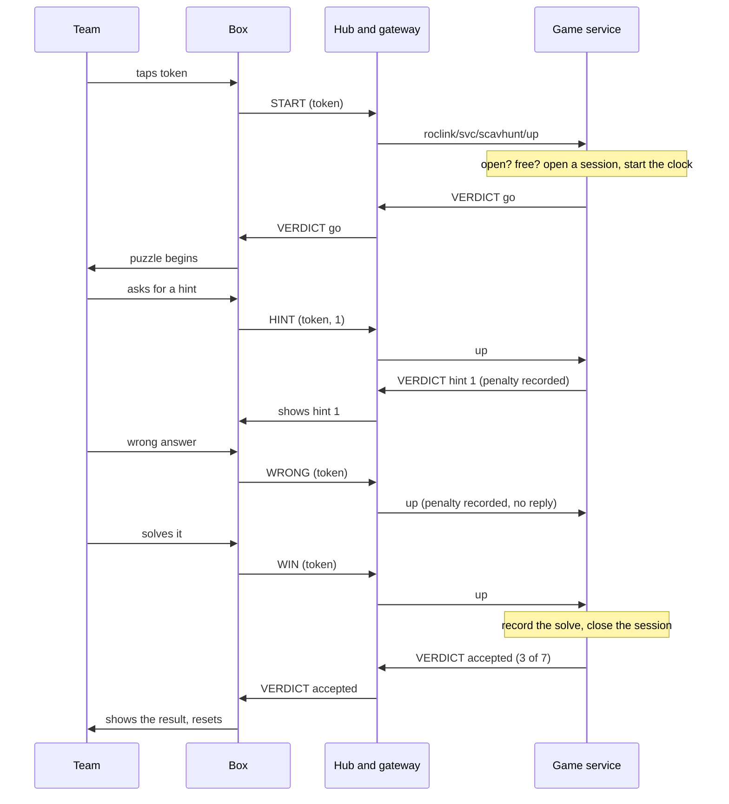
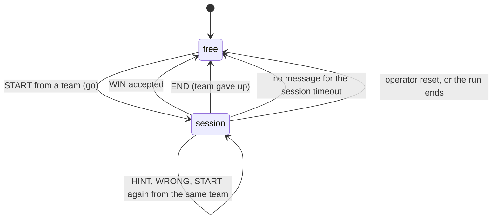
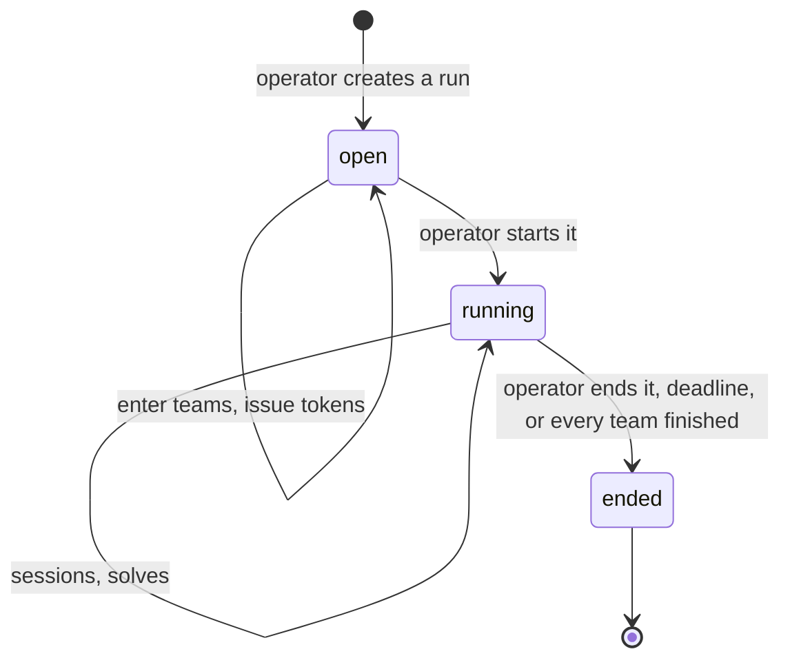
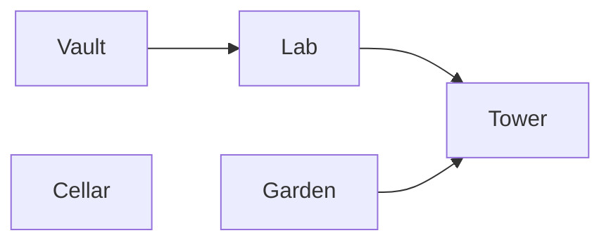
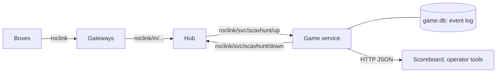

# roclink Scavenger Hunt: game specification

| | |
|---|---|
| Status | Draft |
| Runs on | roclink wire protocol v1 (secured), a roclink hub, and this game service |
| Version | 0.2 |

## 1. The game in one paragraph

Teams move around a space solving physical puzzles: *boxes* built from embedded devices. To play a box, a team taps its *token* on it, which starts a *session*: the game starts timing the team at that box. The team can ask the box for *hints*, each one costing more time than the last, and every wrong answer costs time too. When the team solves the puzzle, the box sends a `WIN` over roclink, and the game records the box as solved and tells the box the result. Every box is worth *points*. A team that has solved every required box has *finished*. Teams are ranked by points, and then by their time at boxes plus penalties.

**Scope.** This document covers the game: its rules, its scoring, and the messages a box exchanges with the game. How a box is built is out of scope: its puzzle, its display, how it reads a token, and the text of its hints.

## 2. Vocabulary

| Term | Meaning |
|---|---|
| **Box** | One physical puzzle, with one roclink node in it. Known to the game by its roclink address `(net, node)`. |
| **Game** | A definition, written once: its boxes, their points and penalties, the order they open in (prerequisites), which boxes are required, the session timeout, and an optional time limit. |
| **Run** | One playing of a game, with a start and an end. A game can be run many times. |
| **Player** | A person playing. The game doesn't track players individually; they play as a team. |
| **Team** | One or more players, entered in a run, who share progress and score. A single player is a team of one. |
| **Token** | What a team taps or types on a box to say who they are: an NFC or RFID card, or a short code. A team can have several tokens (one card per player); each token belongs to exactly one team in a run. |
| **Session** | A team's turn at a box: from the token tap that starts it until the team solves the box, gives up, or goes quiet for the session timeout. A box has at most one session at a time. |
| **Box time** | The total length of a team's sessions at a box, whether or not it solved the box, measured by the server from when it received the box's messages. |
| **Hint** | Help a box gives during a session. Hints at a box are numbered 1, 2, 3 …, and each costs a time penalty at least as large as the one before. |
| **Wrong attempt** | A wrong answer the box reports during a session. Each one costs a time penalty. |
| **Points** | What a box is worth when solved. Required and optional boxes both have points. |
| **Time** | A team's score in time: all its box time, plus its hint and wrong-attempt penalties. Lower is better. |
| **Solve** | A team's accepted claim that it has solved a box. |
| **Progress** | The set of boxes a team has solved in a run. |
| **Prerequisite** | A box another box depends on: box *b* opens for a team once all its prerequisites are in that team's progress. |
| **Open box** | A box whose prerequisites a team has all solved. |
| **Finished** | A team whose progress contains every required box. |
| **Verdict** | The game's answer to a box's message, sent back to the box (§6). |
| **Operator** | Whoever runs the game: defines it, enters teams, starts and ends runs, resets boxes. |

## 3. Formal model

**A game** is *G = (B, pre, R, P, H, W, Δ, L)*:
- *B* is the finite set of boxes.
- *pre : B → 2^B* gives each box's prerequisites. The relation must be acyclic, so every box can be reached.
- *R ⊆ B* is the set of required boxes. By default *R = B*; boxes outside *R* are optional, worth points but not needed to finish.
- *P(b) ≥ 0* is box *b*'s points (default 100).
- *H(b) = (h₁ ≤ h₂ ≤ … ≤ hₘ)* are box *b*'s hint penalties: hint *i* costs *hᵢ*. *m* may be 0 (no hints).
- *W(b) ≥ 0* is box *b*'s penalty per wrong attempt.
- *Δ* is the session timeout.
- *L* is an optional time limit.

**A run** of *G* has:
- a set of teams *T*;
- a token map *tok*, from each token to one team in *T*;
- a state, which is one of `open` (teams can be entered), `running` or `ended`;
- a start time *t₀* and, while running, the deadline *t₀ + L* if *L* is set.

All times are the server's: the time the hub received each box message. Boxes have no clock in the game; a session's length is the difference between the receive times of its messages.

**Progress:** for each team *t*, *S(t) ⊆ B* is the set of boxes it has solved, initially empty. *S(t)* only grows (except by operator correction).

**Open boxes:** box *b* is open for *t* when *pre(b) ⊆ S(t)*.

**Sessions.** A session is *(t, b, s, a)*: team *t* at box *b*, started at *s*, last active at *a* (its latest message). A box has at most one open session. A session is open until the first of:
- an accepted `WIN` from *t* at *b*, at time *e*;
- an `END` from the box, at time *e*;
- *Δ* passing with no message, so *e = a + Δ*;
- the run ending, or the operator closing it, at time *e*.

Its length is *e − s*. A team may hold sessions at several boxes at once.

**A start** *(k, b, τ)* (token *k* tapped to begin at box *b*) opens a session for *t = tok(k)* when the run is running, *k* is known, *b ∉ S(t)*, *pre(b) ⊆ S(t)*, and *b* has no open session of another team. If *t* already has the open session at *b*, the session continues.

**A claim** *(k, b, τ)* (a `WIN`) is **accepted** when all of these hold:
1. the run is `running`, and *τ* is before the deadline;
2. *k* is a known token, so *t = tok(k)* exists;
3. *b ∈ B*;
4. *b ∉ S(t)* (otherwise the verdict is `already solved`);
5. *pre(b) ⊆ S(t)* (otherwise `locked`);
6. *t* has the open session at *b* (otherwise `no session`).

An accepted claim adds *b* to *S(t)*, records a solve *(t, b, τ)*, and closes the session.

**Hints.** During its session at *b*, team *t* has taken *kₜ(b)* hints there. A request for hint *n* is granted when *n ≤ kₜ(b) + 1* and *n ≤ m*. When *n = kₜ(b) + 1*, it costs *hₙ*, and *kₜ(b)* becomes *n*; asking again for a hint already taken costs nothing.

**Wrong attempts.** During its session at *b*, each wrong attempt costs *W(b)*. Outside a session, wrong attempts are recorded but cost nothing.

**Score.** For team *t*:
- points *Π(t) = Σ P(b)* over *b ∈ S(t)*;
- time *𝑇(t)* = the length of all its sessions, plus all its hint penalties, plus all its wrong-attempt penalties.

**Finishing:** team *t* has finished when *R ⊆ S(t)*. Its finish time *f(t)* is the time of the solve that completed *R*.

**The run ends** when the operator ends it, the deadline passes, or every team has finished. Open sessions close when it ends.

**Standings** order teams by these keys:
1. finished teams first;
2. then by points *Π(t)*, most first;
3. then by time *𝑇(t)*, least first;
4. then by the time of the last solve, earliest first.

The *winner* is the first team in the standings, if it has finished.

Time counts only while a team is in a session, not from the start of the run, because every team plays every box: a team that waits for a busy box shouldn't lose to one that didn't have to.

## 4. Rules

1. **One box, one roclink node.** A box is identified only by its roclink address. Its messages are secured (level `enc`), so a box can't be impersonated over the air (roclink PROTOCOL.md §10).
2. **The box decides whether its puzzle is solved; the game decides whether the solve counts.** A box never knows a team's progress or score. It reports what happens and shows the verdict it gets back.
3. **A team starts a box with its token.** The box doesn't begin the puzzle until the game answers `go`. A box that is `locked`, `already solved` or `busy` for that team says so before anyone plays it.
4. **One team at a box at a time.** While a team's session is open at a box, other teams' starts there are answered `busy`, with how long until the session times out.
5. **Every team solves every box.** Boxes are shared. When a session ends, the box resets for the next team.
6. **Order is set by the game.** A start or `WIN` at a box that isn't open for that team is refused as `locked`, and the box says which box to solve first.
7. **The clock runs while a team is at a box.** A session's time counts whether or not the team solves the box. A team that walks away without giving up is charged the full session timeout.
8. **Hints and wrong answers cost time.** Each further hint at a box costs at least as much as the one before; repeating a hint already given is free.
9. **Solving twice changes nothing.** A second `WIN` from the same team for the same box is answered `already solved`.
10. **The server's clock decides.** Every time in the game is when the hub received a box's message, never a time the box reports. Messages after the deadline are refused.
11. **Tokens are per run.** The operator issues them when entering teams. A token that isn't in the run is refused as `unknown team`.
12. **Operators can correct.** The operator can add or remove a solve, and close a session (resetting a box closes its session). Corrections are recorded as events of their own, so the history shows what was changed and when.

## 5. Flows

**Playing a box.** Boxes are mains-powered and *always-listening* (roclink PROTOCOL.md §1), so each verdict reaches the box as soon as the game has decided, without waiting for the box's next uplink.



**A box's session.**



**A run.**



**A team's progress through a game with prerequisites.** Here *Lab* needs *Vault*, and *Tower* needs both *Lab* and *Garden*:



At the start, *Vault*, *Garden* and *Cellar* are open. A start at *Tower* before *Lab* and *Garden* are solved is answered `locked`.

**Any fob plays** (`open_teams`). Before there's registration, the game can enter teams itself: a `START` from a token no team holds first records a `team_entered` event for it (name from `open_team_name`, id from a hash of the token), then is judged like any other. Only a `START`, and only while the run is on, enters a team; replaying the log rebuilds them like any other team.

## 6. Messages

Boxes are one roclink device type, `scavhunt-box`, so these message schemas belong to it alone (roclink PROTOCOL.md §5). All integers are little-endian. Every uplink is sent with `ACK_REQ`.

**Uplinks.** All of them start with the token of the team at the box:

| Bytes | Field | Notes |
|---|---|---|
| 0 | version | 1 |
| 1 | token length *n* | 1–16 |
| 2 … 1+*n* | token | the NFC card's UID, or the bytes of a typed code |
| 2+*n* | hint number | `HINT` only: 1, 2, 3 … |

| Schema | Message | Sent when | Reply |
|---|---|---|---|
| 1 | `WIN` | the team solved the puzzle | `VERDICT` |
| 2 | `START` | a token is tapped to begin | `VERDICT` |
| 3 | `WRONG` | the team gave a wrong answer | none |
| 4 | `HINT` | the team asked for a hint | `VERDICT` |
| 5 | `END` | the team gave up, or the box was reset | none |

A box that resends a request because its verdict was lost gets the same answer again: `go` for a repeated `START`, `already solved` for a repeated `WIN` (which the box should treat as success), and the same hint for a repeated `HINT`, without a second penalty.

**Downlink, schema 10: `VERDICT`.**

| Bytes | Field | Notes |
|---|---|---|
| 0 | version | 1 |
| 1 | result | see below |
| 2 | solved | required boxes this team has solved |
| 3 | required | required boxes in the game |
| 4–5 | arg | depends on the result, else 0 |

| Result | Meaning | Answers | arg |
|---|---|---|---|
| 0 | accepted | `WIN` | |
| 1 | accepted, and the team has finished | `WIN` | |
| 2 | already solved | `START`, `WIN` | |
| 3 | locked | `START`, `WIN` | the node address of a box to solve first |
| 4 | unknown team | `START`, `WIN`, `HINT` | |
| 5 | not running | `START`, `WIN`, `HINT` | |
| 6 | go: the session is open | `START` | hints already taken at this box |
| 7 | busy: another team's session is open | `START` | seconds until it times out |
| 8 | no session | `WIN`, `HINT` | |
| 9 | hint granted | `HINT` | the hint number to show |
| 10 | no more hints | `HINT` | hints this box has |

**Downlink, schema 11: `CONTROL`** (operator). Byte 0 is the version, byte 1 the command: 1 reset the puzzle, 2 disable the box, 3 enable it.

**Schemas 32–255: the box's own data** (not the game's). Whatever a box's builder chooses to send, such as sensor readings, in a layout the hub's config declares. The game ignores them, and the hub's route to the game lists only the game's schemas (1–5, and 10 and 11, since a route also limits the downlink the game may send), so they are only stored. rfidprox forwards them from the box unchanged (its BOXLINK.md).

## 7. Cheating, and what stops it

| Attack | Stopped by |
|---|---|
| Forging a message over the air | roclink security: `enc` level, per-box keys. Only the box's key can produce its messages |
| Replaying a recorded `WIN` | roclink frame counters at the gateway, and the hub's replay window across gateways |
| Claiming for a box out of order | the `locked` rule (§3 condition 5) |
| Claiming without playing | a `WIN` needs the team's open session at that box (§3 condition 6) |
| Walking away to hide box time | a session that times out is charged the full timeout (rule 7) |
| Holding a box to block other teams | the session timeout, and the operator's reset |
| Claiming after time | the hub's clock and the deadline (rule 10) |
| Copying another team's token | Nothing technical; it only gives progress to the other team, and charges it time. Use cards that can't be read at a distance. The scoreboard and its API never show tokens |
| Opening a box and triggering its `WIN` by hand | Physical. A box's key can only send that box's messages, and a stolen box can be revoked (roclink `deny` policy) |

## 8. The backend

The game is a **hub service**: a separate program that the hub delivers its boxes' uplinks to, and that sends downlink back through the hub. The hub stays generic.



- **Input:** the hub delivers each uplink from a `scavhunt-box` as a JSON record on `roclink/svc/scavhunt/up`. It has already been verified, decrypted and de-duplicated across gateways.
- **Output:** a `VERDICT` is a downlink request on `roclink/svc/scavhunt/down`. The hub numbers it and sends it through the gateway that heard the box.
- **State:** an append-only event log in SQLite: team entered, run started, start, claim, hint, wrong attempt, end, session closed, correction, run ended. Each box message is stored with the verdict it got. Progress, sessions, scores and standings are computed from the log, so the history is never lost, and a restart rebuilds the state. Operator commands write to the same log, and the service picks them up.
- **Idempotent:** the hub delivers at least once, so the same uplink can arrive twice. The service ignores a record whose `(net, src, key_gen, fcnt)` it has already handled.
- **Scoreboard:** read-only HTTP JSON (`/api/standings`, `/api/run`). The broker's ACL lets a service write only its own `down` topic, which keeps the scoreboard off MQTT.

**Hub configuration** for the game:

```toml
[[device_type]]
name = "scavhunt-box"
class = "always_listening"

[[node]]
net = 0x42
nodes = ["0x0200-0x02FF"]
type = "scavhunt-box"

[[route]]
service = "scavhunt"
net = 0x42
types = ["scavhunt-box"]
```

## 9. Open questions

None at present.
