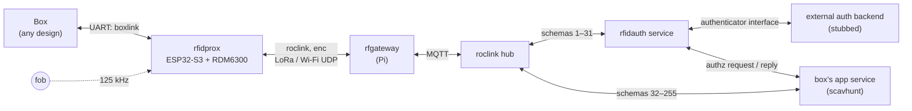
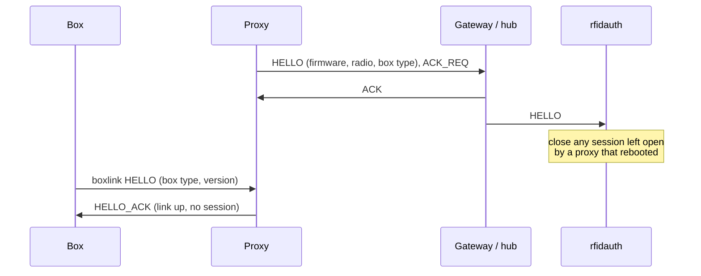
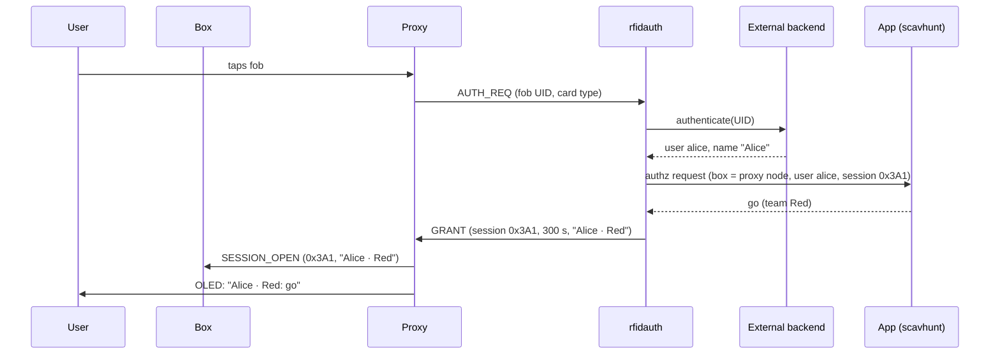
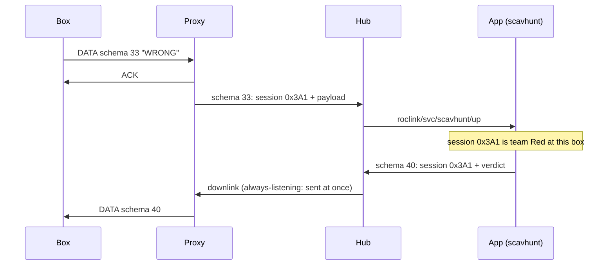
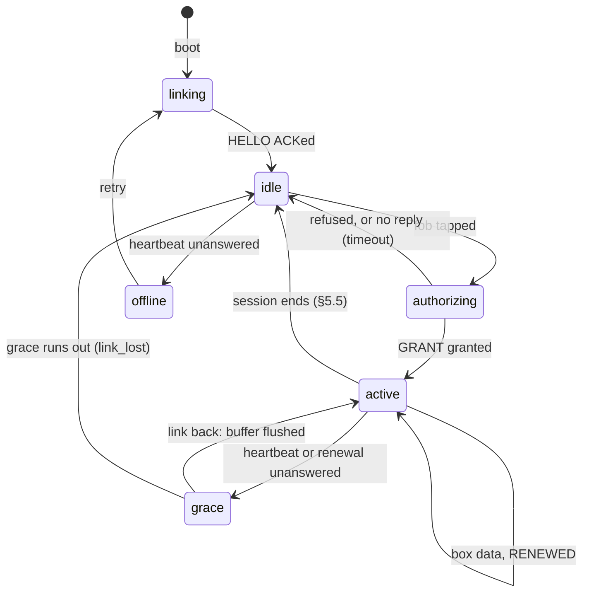

# rfidprox: design

| | |
|---|---|
| Status | Draft, for review before any code is written |
| Version | 0.1 |
| Builds on | roclink wire protocol v1 (`roclink-rfc`), the roclink gateway (`roclink-gateway`), the roclink hub, the scavenger hunt (`roclink-scavhunt`) |

## 1. What it is

rfidprox is a small embedded device that sits between a **box**, an external device of any design, and a roclink backend. It does two jobs:

1. **Authentication.** A person taps an RFID fob on the proxy. The proxy asks the backend, over encrypted roclink, whether that person may use this box now. Only then does it open a **session**.
2. **Proxying.** While a session is open, the proxy carries the box's messages to the backend and the backend's replies to the box. With no session, nothing the box says leaves the proxy.

The box talks to the proxy over a UART with a simple protocol, **boxlink** ([BOXLINK.md](BOXLINK.md)). It never touches the radio, keys or the backend. The proxy is the box's only route out, and the gate on it.

## 2. Vocabulary

| Term | Meaning |
|---|---|
| **Box** | The external device the proxy serves: a puzzle, a machine, anything with a UART. Untrusted: it can only talk through the proxy, and only during a session. |
| **Proxy** | An rfidprox device. One proxy serves one box. It is a roclink node, and the backend knows the box by the proxy's roclink address. |
| **Fob** | A 125 kHz EM4100 tag or card read by the RDM6300. Identified by its 5-byte ID. |
| **User** | The person a fob belongs to, as the external auth backend says. |
| **App** | The backend service that owns a box's behaviour and data, e.g. scavhunt. It decides whether a user may use its box now. |
| **rfidauth** | The hub service that handles proxies' authentication messages. It asks the external backend who a fob belongs to, and the app whether that user may use the box. |
| **Grant** | rfidauth's answer to a granted request: a session id, a lifetime, the user's display name. |
| **Session** | The period in which a user may use a box: from the grant until it is ended, revoked or expires. Box data is forwarded only during a session. |
| **Grace** | The time a session survives while the radio link is down (§6.3). |

## 3. Decisions

| Decision | Choice | Why |
|---|---|---|
| Who authorizes | Split. The external backend **authenticates** (fob → user); the app **authorizes** (may this user use this box now). | The app knows its own rules (the game's `locked`, `busy`, `already solved`); the auth backend shouldn't need to. |
| Fob security | UID only in v1; the messages leave room for challenge-response cards later (§7.4). | UID cards are cheap and enough for a game. A copied UID is a known weakness (§8). |
| Box data | Opaque passthrough. The box chooses a message schema (32–255) and payload; the proxy adds the session id and forwards it unchanged. | New boxes need no proxy firmware change. The app decodes its own messages. |
| Identity in the game | rfidauth gives the app a **user id**; the app maps users to teams. | Raw fob UIDs never reach the app. |
| External backend | Unknown. rfidauth has an authenticator interface, with a stub reading a file of fobs. | The real backend plugs in later without touching the proxy or the protocol. |
| Link loss | Keep the session for a grace period, buffering box data; then close it. | LoRa drops the odd packet; a hard close on one lost heartbeat would end sessions for nothing. |
| UART | 3.3 V TTL, 115200 8N1, box self-powered. | Matches the ESP32 directly; 5 V boxes add a level shifter on their side. |
| First board | Heltec WiFi LoRa 32 V3 ([HARDWARE.md](HARDWARE.md)). | SX1262 and an OLED on board, plenty of free GPIOs. |

## 4. Roles and trust

| Party | Holds | Trusted to |
|---|---|---|
| **Proxy** | its roclink node key (provisioned at flashing, kept in NVS); the current session | read fobs honestly, enforce the gate, keep the session state |
| **Box** | nothing | nothing. It can't open a session, and its data is attributed to whoever holds the session |
| **Gateway** | the network master key (or, later, enrolled node keys) | verify and decrypt frames, as for any roclink node |
| **Hub** | routes | deliver each schema range to the right service |
| **rfidauth** | sessions; the authenticator's credentials | authenticate fobs, ask the app, issue and revoke grants |
| **App** | its own rules; users-to-teams | decide whether a user may use its box; interpret box data |
| **External backend** | the fob registry | say who a fob belongs to, and whether it is valid |

Every roclink frame between the proxy and the backend is encrypted and authenticated with the proxy's node key, so the backend knows a message came from that proxy, unaltered and not replayed. The grant is therefore not a bearer secret: it is a session id the backend can check and revoke, carried on every forwarded message.

The proxy's **identity and network settings** (net id, node address, key) are provisioning, set when the device is flashed (`roclink-rfc/tools/provision.py`). They can't come from the backend over roclink, because without them the proxy can't talk to it at all.

## 5. Flows

### 5.1 Start-up

The proxy sends `HELLO` at boot and whenever it reconnects. rfidauth closes any session it still holds for that proxy and tells the app.

### 5.2 Opening a session

A refusal at any step comes back as a `GRANT` with a result code and, from the app, its own verdict and argument (for example `locked`, needs box 0x0201), so the proxy can show why.

### 5.3 Box data during a session

### 5.4 Keeping it alive

- **Link heartbeat.** The proxy sends a roclink `PING` (schema 0) with `ACK_REQ` every heartbeat interval. The gateway's ACK proves the radio link. It does not prove the backend is up.
- **Grant renewal.** At two thirds of the grant's lifetime the proxy sends `RENEW`. rfidauth re-checks the user with the external backend and the session with the app, and answers `RENEWED` with a new lifetime, or `SESSION_CLOSE`. Renewal is the end-to-end check.
- **roclink keys** ratchet daily as for any node; the proxy persists its frame counter and chain key (PROTOCOL.md §10.4, §10.5).

### 5.5 Ending a session

A session ends when the first of these happens:

| Cause | Who | Reason code |
|---|---|---|
| The box ends it (puzzle solved, user gave up) | box → proxy → rfidauth | `box_ended` |
| The app or an operator revokes it | app → rfidauth → proxy | `revoked` |
| The grant expires without a successful renewal | proxy and rfidauth independently | `expired` |
| The link is down for longer than grace | proxy | `link_lost` |
| The box disappears (no boxlink traffic for the box timeout) | proxy | `box_lost` |
| The proxy restarts | rfidauth, on the next `HELLO` | `proxy_restart` |

Whoever notices first tells the others: the proxy sends `SESSION_END` uplink and boxlink `SESSION_CLOSED`; rfidauth sends `SESSION_CLOSE` downlink and tells the app.

## 6. The proxy

### 6.1 States

| State | Fob tap | Box DATA | Display |
|---|---|---|---|
| `linking` / `offline` | "offline", ignored | refused: `no_session` | "Connecting…" |
| `idle` | starts `authorizing` | refused: `no_session` | "Tap your card" |
| `authorizing` | ignored | refused: `no_session` | "Checking…" |
| `active` | same fob: nothing; another fob: "in use" | forwarded | user's name |
| `grace` | "in use" | buffered, up to the buffer limit | name + "reconnecting" |

### 6.2 The gate

The gate is the proxy's most important rule. **Box DATA is forwarded only in `active` (or buffered in `grace`), and only with the current session id.** Downlink box data is delivered to the box only if its session id is the current one. A session id from an ended session is dropped.

### 6.3 Grace and buffering

- On entering `grace`, the proxy tells the box (`STATUS: link down`) but keeps the session open.
- Box DATA is buffered in RAM up to a limit (default 4 KiB or 32 messages). Beyond it, the box gets `NAK busy`, and must hold or drop the data itself.
- If the link returns within grace (default 60 s), the proxy flushes the buffer in order, then renews the grant.
- If not, the session closes with `link_lost`. The buffer is discarded, and the box is told.

### 6.4 Radio

The proxy is an **always-listening** roclink node (mains-powered), so downlink reaches it at once. The radio is a transport behind one interface (send a frame, receive a frame), so the same firmware runs over:

| Transport | Status | Notes |
|---|---|---|
| LoRa (SX1262) | first | 915.0 MHz, SF9/125 kHz, sync word 0x12, matching the rfgateway. About 200 ms on air per 20-byte frame: budget accordingly (§6.5). |
| Wi-Fi UDP | first | To the gateway's UDP port 3333, as `tools/test_node.py` does. Jumbo frames possible, but capped at 255 bytes for one code path. |
| ESP-NOW | later | Needs an ESP-NOW gateway, which doesn't exist yet. |
| Wi-Fi HaLow | later | IP, so the UDP transport over a HaLow module and access point. |

### 6.5 Rate limits

LoRa limits what a box can send. The grant carries a budget (messages per minute), and the proxy enforces it with a token bucket. Over budget, the box gets `NAK busy`. Defaults: 6 messages per minute over LoRa; 120 over Wi-Fi.

## 7. Backend

The roclink messages are in [BACKEND.md](BACKEND.md). In summary:

### 7.1 Schemas

The proxy is one roclink device type, `rfidprox`. Its schemas split in two, and the hub routes each half to a different service:

| Schemas | Owner | Messages |
|---|---|---|
| 0 | roclink | `PING` |
| 1–31 | rfidauth | `HELLO`, `AUTH_REQ`, `RENEW`, `SESSION_END`, `STATUS`; `GRANT`, `RENEWED`, `SESSION_CLOSE` |
| 32–255 | the box's app | box data in both directions, each prefixed with the session id |

### 7.2 rfidauth

A new hub service. It:

- handles schemas 1–31 from every `rfidprox` node;
- authenticates fobs through an **authenticator** interface: `authenticate(uid, card_type) → user | unknown | disabled`. v1 has a stub that reads `fobs.toml`;
- knows which app owns each proxy (`boxes.toml`: node → app, box id);
- asks the app to authorize over MQTT (§7.3), and tells it when sessions open and close;
- keeps sessions (id, node, user, expiry) in SQLite, so a restart doesn't forget them.

### 7.3 rfidauth ↔ app

Service to service, on the broker, not through the hub:

| Topic | From → to | Message |
|---|---|---|
| `roclink/authz/<app>/request` | rfidauth → app | `{"id", "box", "node", "user", "session", "op": "open" \| "renew"}` |
| `roclink/authz/<app>/reply` | app → rfidauth | `{"id", "result": "go" \| "deny", "verdict", "arg", "label"}` |
| `roclink/authz/<app>/session` | rfidauth → app | `{"session", "node", "user", "state": "open" \| "closed", "reason"}` |
| `roclink/authz/<app>/revoke` | app → rfidauth | `{"session", "reason"}`: end a session (e.g. an operator reset) |

The app answers with its own verdict (`verdict`, `arg`) so the proxy can show it. `label` is a short string for the proxy's display ("Red").

### 7.4 Room for cryptographic cards

`AUTH_REQ` carries an auth method (0 = UID). A later method (1 = challenge) adds a round: rfidauth sends `CHALLENGE`, the proxy relays it to the card and returns the card's answer in `AUTH_REQ` again. Schema 19 is reserved for `CHALLENGE`. The RDM6300 only reads EM4100 IDs, which have no cryptography: this needs a 13.56 MHz reader (a PN532 for NTAG424 or DESFire).

## 8. Security notes

| Threat | Mitigation |
|---|---|
| Forging or replaying proxy messages over the air | roclink `enc`, per-node keys, frame counters |
| Copying a fob's UID | Not stopped in v1. A copied fob is that user. EM4100 tags are read from a few cm away and copied with cheap tools. Challenge-response cards later (§7.4); revoke the user at the external backend meanwhile. |
| A box sending data with no one authorized | The gate (§6.2): nothing leaves the proxy without a session |
| A box sending data under someone else's session | Not preventable: the box is whatever is attached. Data is attributed to the session holder, and the app can judge it. |
| A stolen proxy | Its key can speak for that one box. Revoke the node at the gateway (`deny = 42:NODE`) and in `boxes.toml`. |
| A stale session after a revocation | Every forwarded message carries the session id; rfidauth and the app drop unknown or closed ids. |
| Fob UIDs as personal data | Sent only to rfidauth, which passes them to the authenticator and logs only a hash. The app sees user ids. |

## 9. What this changes elsewhere

| Repository | Change |
|---|---|
| `roclink-scavhunt` | GAME.md 0.3. A box's `START` becomes rfidauth's authz request: the app judges it as now (go, locked, busy…) and opens the game session. `WIN`, `WRONG`, `HINT` and `END` move to schemas 32+ and carry the session id instead of a token. Teams list user ids instead of card UIDs. |
| `roclink-gateway` | Deploy the hub, rfidauth and the app on the Pi (new roles); MQTT users `rfidauth` and per-app; ACL for `roclink/authz/#`. |
| roclink hub | Routes for device type `rfidprox`: schemas 1–31 to rfidauth, 32–255 to each box's app. Nothing new in the hub itself. |
| roclink library | Node-side `PING` (specified, not yet built). |

## 10. Open questions

1. **Where `roclink/authz/…` belongs.** Defined here for now; it might belong in the hub interface draft instead, since any app could use it.
2. **Defaults over LoRa:** heartbeat interval, grant lifetime, grace, rate budget. The values above are guesses until measured on air.
3. **Regulatory.** In the US, a single fixed 125 kHz LoRa channel at 915 MHz fits neither of FCC Part 15.247's options (frequency hopping over at least 50 channels, or at least 500 kHz of bandwidth), so it would have to stay within §15.249's much lower power limits. This matters for the whole roclink LoRa setup, not just rfidprox, and should be checked before a permanent installation.
4. **HaLow module and ESP-NOW gateway.** Which HaLow module, and how an ESP-NOW gateway attaches to the Pi.
